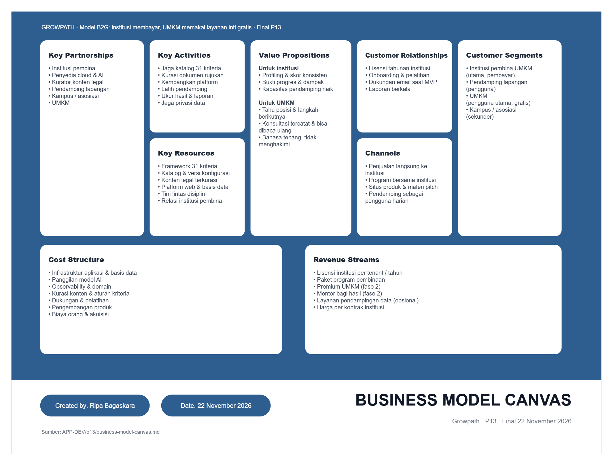

# BUSINESS MODEL CANVAS GROWPATH

**Deliverable:** PR14-02
**Pemilik:** Ripa Bagaskara
**Disusun oleh:** Tim Growpath P13, 22 November 2026
**Status:** Final P13, dibekukan 22 November 2026

## Canvas

Sumber editable: `diagrams/P13-Business-Model-Canvas.drawio`.

## 1. Ringkasan model

Growpath memakai model B2G. Institusi pembina membayar lisensi atau paket program, UMKM memakai layanan inti gratis, dan layanan premium serta mentor masuk fase 2. Pendapatan berasal dari lisensi institusi dan paket program.

## 2. Sembilan blok

### 2.1 Customer segments

| Segmen | Keterangan | Prioritas |
|---|---|---|
| Institusi pembina UMKM | Kementerian, dinas koperasi dan UKM, inkubator, koperasi sekunder, program CSR | Utama |
| Pendamping lapangan | Fasilitator yang mendampingi banyak UMKM | Pengguna, bukan pembayar |
| UMKM | Pemilik usaha yang butuh panduan | Pengguna utama, layanan inti gratis |
| Institusi pendidikan dan asosiasi | Kampus, politeknik, asosiasi UMKM | Sekunder |

### 2.2 Value propositions

Untuk institusi:

- Profiling dan skor yang konsisten, bisa dibandingkan antar UMKM.
- Bukti progres dan laporan dampak, bukan narasi tanpa data.
- Kapasitas pendamping bertambah tanpa menambah jumlah orang secara linear.

Untuk UMKM:

- Tahu posisi usaha dan satu langkah berikutnya.
- Konsultasi yang tercatat dan bisa dibaca ulang.
- Bahasa yang tenang, tidak menghakimi, dan tidak menuntut istilah akuntansi.

### 2.3 Channels

- Penjualan langsung ke institusi melalui proposal dan demo.
- Program bersama institusi pembina.
- Situs produk dan materi pitch.
- Pendamping sebagai pengguna harian yang memperkenalkan ke UMKM.

### 2.4 Customer relationships

- Kontrak lisensi tahunan dengan institusi.
- Onboarding dan pelatihan pendamping.
- Dukungan teknis melalui email pada MVP.
- Laporan berkala untuk institusi.

### 2.5 Revenue streams

| Sumber | Model |
|---|---|
| Lisensi institusi | Per tenant per tahun, jumlah UMKM tercakup |
| Paket program | Per program pembinaan dengan jumlah UMKM tertentu |
| Premium UMKM | Fitur lanjutan, fase 2 |
| Mentor | Bagi hasil sesi, fase 2 |
| Layanan pendampingan data | Implementasi dan pelatihan |

Harga per kontrak institusi.

### 2.6 Key resources

- Framework 31 kriteria dan aturan skor.
- Katalog kriteria dan versi konfigurasi.
- Kekayaan pengetahuan legal dan pembinaan yang terkurasi.
- Platform web dan basis data.
- Tim kecil yang menguasai bisnis, data, aplikasi, dan AI.
- Relasi dengan institusi pembina.

### 2.7 Key activities

- Menjaga kualitas katalog kriteria dan aturan skor.
- Mengkurasi dokumen rujukan dan memverifikasi sumber.
- Mengembangkan dan mengoperasikan platform.
- Melatih pendamping dan institusi.
- Mengukur hasil dan menyusun laporan dampak.
- Menjaga keamanan dan privasi data UMKM.

### 2.8 Key partnerships

| Mitra | Peran |
|---|---|
| Institusi pembina | Pengguna dan pembayar |
| Penyedia cloud dan AI | Infrastruktur dan model |
| Kurator konten legal | Menjaga akurasi rujukan |
| Pendamping lapangan | Pengguna dan umpan balik |
| UMKM | Pengguna utama dan mitra umpan balik |
| Kampus | Riset dan masukan |

### 2.9 Cost structure

| Komponen | Sifat | Catatan |
|---|---|---|
| Infrastruktur aplikasi dan basis data | Bulanan, sebagian variabel | Rincian di `hosting-options.md` |
| Panggilan model AI | Variabel per konsultasi | Rincian di `hosting-options.md` |
| Observability dan domain | Bulanan kecil | Komponen biaya |
| Kurasi konten dan aturan kriteria | Waktu orang | Komponen biaya |
| Dukungan dan pelatihan | Waktu orang | Komponen biaya |
| Pengembangan produk | Waktu tim | Komponen biaya |
| Biaya orang dan akuisisi | Waktu orang | Komponen biaya |

## 3. Hubungan dengan arsitektur

| Blok BMC | Artefak arsitektur terkait |
|---|---|
| Value proposition | `vision-v1.md`, `use-cases.md` |
| Customer segments | `vision-v1.md` bagian pemangku kepentingan |
| Channels | `../../01_Business/README.md`, peta aplikasi |
| Revenue streams | `hosting-options.md` untuk sisi biaya |
| Key resources | `erd-3nf.md`, katalog 31 kriteria |
| Key activities | `bpmn-target.md` |
| Cost structure | `hosting-options.md`, `nfr.md` |
